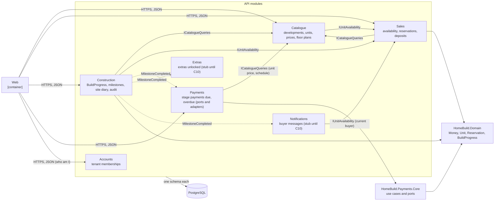

# Components of the API (C4 level 3)

Each module is a component inside `HomeBuild.Api` with its own schema. Modules call each other only through published interfaces (solid arrows) or react to events after commit (dotted arrows). Accounts turns each request's token into a tenant claim (a claims transformation) that every module's queries filter on. Payments' rules live in `HomeBuild.Payments.Core` (ports and adapters); the other modules are vertical slices.

