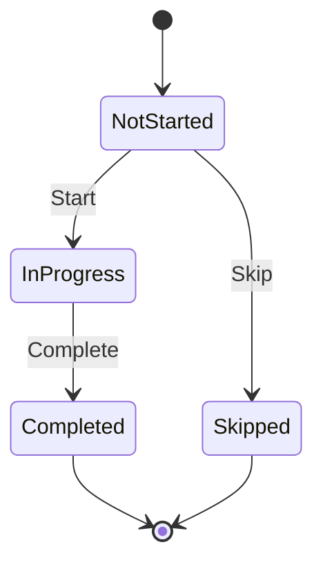

# Milestone states

Each milestone of a unit's `BuildProgress` moves through these states (C7 Lab 2). Each state is a class in `src/HomeBuild.Domain/MilestoneState.cs` that decides which transitions it allows; anything else is refused with a result, never an exception.

`MilestoneStateTableTests.State_diagram_matches_the_transition_table` draws this diagram from the state classes' real behaviour and fails when the block below differs; its message prints the block to paste.

Rules between milestones (in order, dates not before the previous milestone, practical completion last) belong to the `BuildProgress` aggregate, not to the states.
