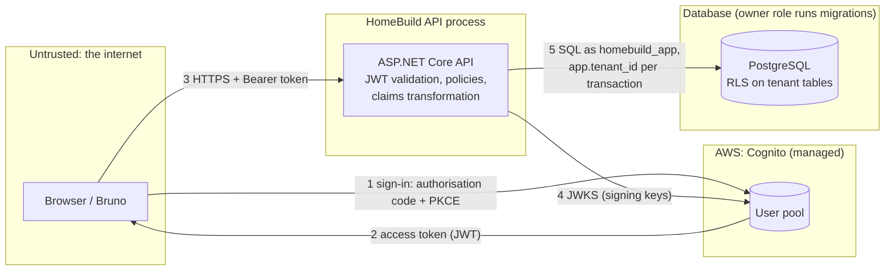

# Threat model: the reservation flow

Scope: a buyer (or a sales agent) signs in through Cognito and reserves a unit through the HomeBuild API, which
stores it in PostgreSQL. Reviewed in C4 Lab 6; update it with every change to authentication, authorisation or data.

## Data flow and trust boundaries

Trust boundaries: browser ↔ API (flow 3: everything in a request is attacker-controlled), browser ↔ Cognito (1, 2),
API ↔ Cognito (4: keys fetched over HTTPS), API ↔ PostgreSQL (5: the API is trusted, but RLS still checks the tenant).

## STRIDE

| # | Element / flow | Threat | Mitigation | Proof |
| --- | --- | --- | --- | --- |
| S1 | Flow 3 | Spoofing: a forged or tampered token (e.g. payload changed to the admin group) | Signature, issuer, lifetime validated (JWT bearer) | red-team `13 Role escalation via forged group` → 401 |
| S2 | Flow 3 | Spoofing: an ID token or another app's token presented as an access token | `token_use = access` and `client_id` allow list | `Id_token_used_as_access_token_returns_401`, `Token_from_other_client_returns_401`, red-team `12` |
| S3 | Flow 3 | Spoofing: a replayed expired token | Lifetime validation (5 min skew) | `Expired_token_returns_401` |
| S4 | Flow 1 | Spoofing: a stolen authorisation code | PKCE on the public client; short-lived codes | Accepted risk: Cognito enforces the verifier; no HomeBuild code to test (C5's BFF adds a confidential client) |
| T1 | API: reserve | Tampering: mass assignment (`status`, `state`, `tenantId` in the body) | Request DTOs carry only `buyerId`, `deposit`, `currency`; state set by the domain; tenant from the membership | red-team `05`–`07` (still `Held`, own tenant) |
| T2 | API: reserve | Tampering: a buyer reserving for someone else (`buyerId`) | Buyers reserve as their `sub`; only sales agents name a buyer | red-team `08` → 403; `Access_table_is_enforced` |
| T3 | API: search | Tampering: SQL injection in `q` | EF Core parameters, `websearch_to_tsquery` | red-team `09`–`11` (no rows, table intact) |
| T4 | Flow 5 | Tampering: writing rows into another tenant | RLS `WITH CHECK`; tenant stamped from the membership | `Tenant_A_buyer_token_cannot_reach_tenant_B_data` |
| R1 | API | Repudiation: a user denies reserving | `ReservationLog` events 1001–1004 with unit and reservation IDs, trace IDs in ProblemDetails | Accepted for now: logs don't yet carry the user's `sub` (C14 adds audit fields) |
| I1 | API: reservations | Information disclosure: BOLA (another buyer's reservation or deposit) | Resource-based ownership check; 404 for non-owners | red-team `02`–`04`; `Buyer_cannot_read_other_buyers_reservation_returns_404` |
| I2 | Flow 5 | Information disclosure: another tenant's data, including through raw SQL or a missing filter | Query filters + RLS as a non-owner role | `IgnoreQueryFilters_still_returns_only_current_tenant_rows`, `Header_tenant_is_ignored` |
| I3 | API | Information disclosure: stack traces, SQL in errors | Exception handler returns ProblemDetails without details | `Unhandled_exception_returns_500_problem_without_details` |
| I4 | API | Information disclosure: probing IDs through 403 vs 404 | 404 for objects the caller may not see | red-team `02`–`04` |
| D1 | API | Denial of service: oversized request bodies | Kestrel `MaxRequestBodySize` 64 KB (was the 30 MB default: **finding**, fixed in Lab 6) | red-team `14 Oversized body` → 413 |
| D2 | API: reserve | Denial of service: reservation flooding | Rate limiter: 10 per minute per partition, 429 with `Retry-After` | `Eleventh_reservation_in_a_minute_returns_429` |
| E1 | API | Elevation of privilege: a forged group claim | Groups only from a validly signed token | red-team `13` → 401 |
| E2 | API | Elevation of privilege: a staff action by a buyer (create a development, cancel after deposit) | Named role policies; ownership + state rule on cancel | `Access_table_is_enforced` (40 rows) |
| E3 | API | Elevation of privilege: anonymous access to Sales data | Fallback policy requires an authenticated user | red-team `15` → 401; `Catalogue_reads_are_anonymous` |

## Findings from the red team (productive failure)

| Finding | How it showed | Fix | Test |
| --- | --- | --- | --- |
| A 2 MB reservation body was accepted and created a reservation | red-team `14`: `expected 201 to equal 413` | `MaxRequestBodySize = 64 KB` | red-team `14` |
